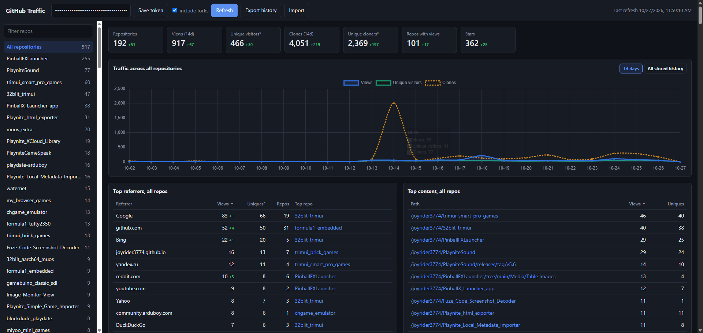

# github repository referrers statistics html page
A Claude.ai generated standalone, javascript based html page that grabs the traffic information (referrers, popular content, views and clones) of your own created github projects and displays it per repository and as an overview across all repositories.
Just provide a github token and it will fetch all your own created repo's (forks are skipped unless you tick "include forks") and display their traffic data.

## What it shows
### Overview (all repositories)
- Totals: repositories, views, unique visitors, clones, unique cloners, repos with views and stars
- A combined daily chart of views, unique visitors and clones across all repos
- Top referring sites summed across all repos, with how many repos each one refers to and which repo gets the most from it
- Top popular content (paths) across all repos
- A sortable table of all repos with views, uniques, clones, cloners, stars and their top referrer

### Per repository
- Views, unique visitors, clones, unique cloners, stars and forks
- A daily chart of views, unique visitors and clones
- Referring sites and popular content (paths and page titles)
- Links to the repository and its GitHub traffic page

All tables can be sorted by clicking a column header, and the sidebar can be filtered to quickly find a repo.

## Difference tracking
When refreshed the app shows little red or green difference information compared to the previous refresh, for totals, per-repo numbers and referrers. Referrers that weren't there on the previous refresh are marked as "new".

## History beyond 14 days
GitHub only keeps traffic data for the last 14 days. Every refresh stores the daily views and clones in the browser, so the "All stored history" chart keeps growing over time as long as you refresh at least once every 14 days.
Use "Export history" to save this data to a json file as a backup and "Import" to merge it back in, for example in another browser or on another PC.
Referrers and popular content are only available as the current 14 day top 10 per repo, so those are not kept as history.

## Token
The traffic API requires push access to a repository, so this only works for your own repos. Use a classic token with the `repo` scope (or `public_repo` for public repos only), or a fine-grained token with "Administration: read" repository permission.

## Privacy
The page is a completely self driven javascript application. The github token is stored locally in your browser and is only sent to the github api. The fetched data and the history are also only stored locally in your browser. The only external resource loaded is the Chart.js library from cdnjs to draw the charts.
You can view or download the code from the github repo itself to verify this.

## Preview

## App Link
[github_traffic.html](https://joyrider3774.github.io/github-traffic-stats/github-traffic-stats.html)
